# 3D Ray Tracing Engine (Project CSI - Visual and Analytical Computing)

<p align="center">
  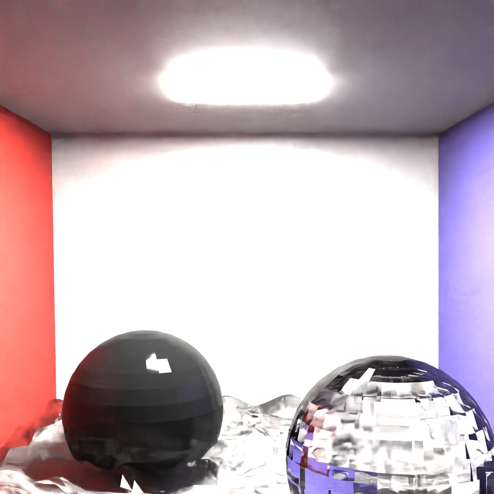
</p>

A high-performance **Monte Carlo Path Tracer** with an interactive GUI, built from scratch in C++17. This project implements physically-based rendering (PBR) techniques including GGX microfacet materials, Bounding Volume Hierarchy (BVH) acceleration, and AI-powered denoising.

## 🎯 Features

### Light transport
- **Unidirectional Monte Carlo path tracer**, iterative, with a deterministic random stream per pixel sample (same seed, same image, for any thread count)
- **Next event estimation** for every light type: area lights (triangles, quads, spheres), point lights, the sun, and the environment
- **Multiple importance sampling** of light and BSDF sampling with the power heuristic. `--integrator mis|bsdf|nee` switches strategies for ablations
- **Russian roulette** after a configurable depth, with the 1/η² radiance scaling factored out inside glass
- **Importance-sampled HDR environments** (Radiance `.hdr`, or sRGB-decoded PNG/JPG)

### Materials
- Every material implements `sample` / `eval` / `pdf`, and the three are tested for mutual consistency
- **Metallic-roughness PBR**: GGX microfacets, height-correlated Smith masking, visible-normal sampling, and energy-conserving diffuse coupling (Kelemen & Szirmay-Kalos)
- **Smooth dielectrics** (glass, water) with exact Fresnel and radiance compression across the interface
- Lambertian (solid or textured, sRGB-decoded), conductors, diffuse translucency, isotropic media

### Acceleration
- **Binned-SAH BVH**, flattened and traversed iteratively, with front-to-back ordering and early-exit shadow rays. Per-mesh BVHs store triangles by value
- Multi-threaded tile renderer
- Intel OIDN denoiser integration (optional)

### Verification
- **43 correctness tests** (`ctest`): χ² goodness-of-fit for every BSDF sampler, sample/pdf consistency for every light, analytic irradiance from rectangle, triangle, sphere, point, sun, sky and environment lights under each strategy, a white furnace test, BVH vs. brute force, Gaussian fields against closed forms and brute force, determinism, and a statistical regression test against stored references
- Runs in CI on Linux and macOS, and under AddressSanitizer + UBSan

### Measurement
- **Equal-time rendering** (`--time-budget`) with per-pass error logging against a reference: MSE, relMSE, MAPE and **HDR-FLIP** (NVIDIA's reference implementation, validated against its published values)
- Per-pixel variance output and **reference-noise-corrected** error
- `rt_compare` image comparison tool; ray counts and Mrays/s
- A six-scene benchmark suite (including Veach's MIS scene and an HDR sun-and-sky environment), plus scripts for references, equal-time sweeps and convergence plots. See [docs/BENCHMARKING.md](docs/BENCHMARKING.md)
- **3D Gaussian Splatting captures in the path tracer**: standard 3DGS `.ply` files (SH up to degree 3) rendered with the 3DGRT particle model, lighting and shadowing inserted geometry. See [docs/GAUSSIAN_FIELDS.md](docs/GAUSSIAN_FIELDS.md)
- **Multi-view dataset export** for 3D Gaussian Splatting: training and test views with poses (`transforms.json`), depth, normals and an initial point cloud, plus ground-truth test views with synthetic objects inserted. See [docs/DATASETS.md](docs/DATASETS.md)

### Interactive GUI
- Real-time **progressive rendering**
- **WASD + mouse** camera controls
- Live material and lighting adjustments
- Scene file hot-reloading

---

## � Documentation

For a comprehensive technical documentation covering all algorithms, mathematical foundations, and implementation details, see:

📄 **[Project_Documentation.pdf](Project_Documentation.pdf)** - Complete 13-page technical report

> Note: the PDF describes the original course submission. The integrator,
> materials and BVH have since been rewritten (see Features above).

The documentation includes:
- Rendering equation and Monte Carlo integration theory
- Ray-scene intersection algorithms (Möller-Trumbore)
- BVH construction with Surface Area Heuristic
- Material models (Lambertian, GGX, Dielectric)
- Importance sampling techniques (MIS, NEE, Russian Roulette)
- System architecture and performance analysis

---


## �🛠️ Tools & Technologies

| Category | Technology |
|----------|------------|
| Language | C++17 |
| Build System | CMake 3.16+ |
| GUI | Dear ImGui + GLFW + OpenGL |
| Math | GLM |
| Scene Format | XML (tinyxml2) + OBJ/MTL |
| Denoising | Intel Open Image Denoiser (OIDN) |
| Image I/O | stb_image, stb_image_write |

---

## 📋 Prerequisites

Ensure you have the following installed:

- **CMake** 3.16 or higher
- **C++17 compatible compiler** (GCC 9+, Clang 10+, MSVC 2019+)
- **OpenGL** 3.3+ compatible GPU and drivers
- **Git** (for cloning)

### macOS
```bash
brew install cmake glfw
```

### Ubuntu/Debian
```bash
sudo apt update
sudo apt install cmake build-essential libglfw3-dev libgl1-mesa-dev
```

### Windows
- Install [Visual Studio 2019+](https://visualstudio.microsoft.com/) with C++ workload
- Install [CMake](https://cmake.org/download/)

---

## 🚀 Build Instructions

### 1. Clone the Repository
```bash
git clone --recursive https://github.com/ab17dogar/project-csi.git
cd project-csi
# already cloned without --recursive? fetch the GUI dependencies:
git submodule update --init
```
The GUI needs the `glfw` and `imgui` submodules. Without them the core library,
CLI and tests still build.

### 2. Create Build Directory
```bash
mkdir build
cd build
```

### 3. Configure with CMake
```bash
cmake ..
```

### 4. Build the Project
```bash
cmake --build . --config Release -j$(nproc)
```

Or on Windows:
```bash
cmake --build . --config Release
```

---

## ▶️ Running the Application

### Interactive GUI Mode
```bash
# From the build directory
./RaytracerGUI
```

### Command-Line Renderer
```bash
# Render with default settings
./Raytracer

# Render a specific scene
./Raytracer --scene cornell_water_scene.xml --bvh --samples 500

# Full options
./Raytracer --help
```

### CLI Options
| Flag | Description |
|------|-------------|
| `--scene <file>` | Scene XML file (default: objects.xml) |
| `--out <file>` | Output image path (PNG is sRGB-encoded) |
| `--pfm <file>` | Also write linear HDR radiance (for error measurements) |
| `--width <W>` | Override image width |
| `--samples <S>` | Samples per pixel |
| `--max-depth <N>` | Maximum bounces (1 = direct lighting only) |
| `--integrator <X>` | `mis` (default), `bsdf` or `nee` |
| `--seed <N>` | Random seed; same seed gives the same image |
| `--bvh` / `--linear` | BVH (default) or brute-force intersection |
| `--denoise` / `--no-denoise` | OIDN denoising (default on if available) |
| `--preset <name>` | Use preset: Preview, Draft, Final |

Measurement mode (progressive, no denoising):

| Flag | Description |
|------|-------------|
| `--time-budget <S>` | Render for S seconds of render time |
| `--progressive` | Passes of doubling spp up to `--samples` |
| `--reference <F.pfm>` | Log error against a reference after every pass |
| `--ref-variance <F.pfm>` | Reference variance, to subtract its noise from the error |
| `--log <F.csv>` | Per-pass CSV: time, spp, rays, MSE, relMSE, MAPE, FLIP |
| `--variance-out <F.pfm>` | Per-pixel variance of the mean |
| `--label <name>` / `--no-flip` | Method label in the log / skip FLIP |

### Running the Tests
```bash
cmake --build build --target raytracer_tests
ctest --test-dir build --output-on-failure   # or ./build/raytracer_tests [filter]
```

---

## 📁 Project Structure

```
project-csi/
├── assets/                 # Scene files and 3D models
│   ├── *.xml              # Scene definitions
│   ├── *.obj              # 3D mesh files
│   └── *.mtl              # Material files
├── src/
│   ├── engine/            # Core ray tracing engine
│   │   ├── camera.h/cpp   # Camera model
│   │   ├── material.h     # Material base class
│   │   ├── bvh_node.h/cpp # BVH acceleration
│   │   ├── render_runner.cpp # Tile-based renderer
│   │   └── ...
│   ├── gui/               # ImGui application
│   └── 3rdParty/          # External libraries
├── renders/samples/       # Sample output images
├── build/output/          # Rendered output directory
├── CMakeLists.txt
└── README.md
```

---

## 🖼️ Sample Outputs

### Hundred Spheres with Sharp Shadowing and Lighting using BVH


*Demonstrates refraction, caustics, and global illumination*

### GGX Material Test
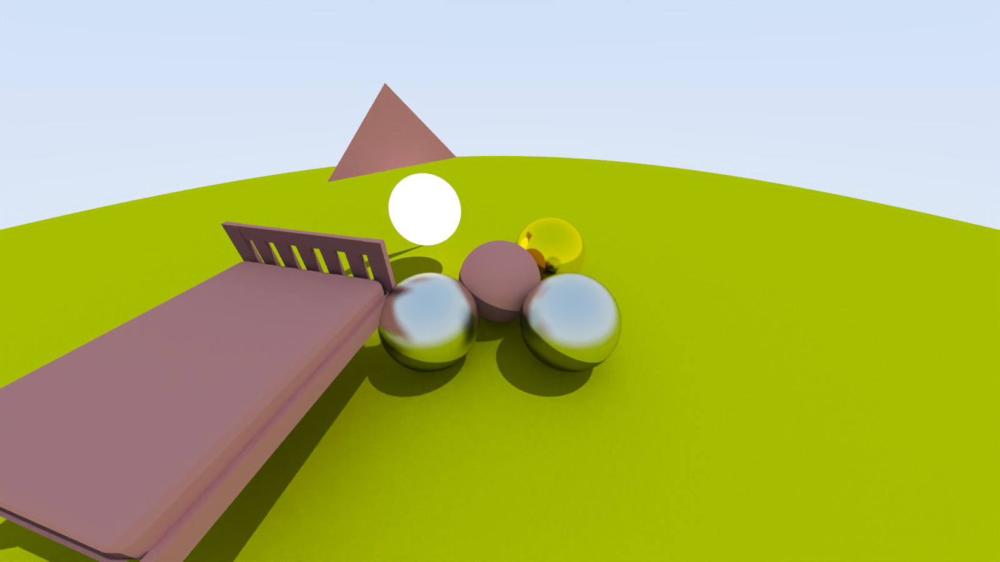

*Showcases metallic roughness variations*

### 100 Spheres
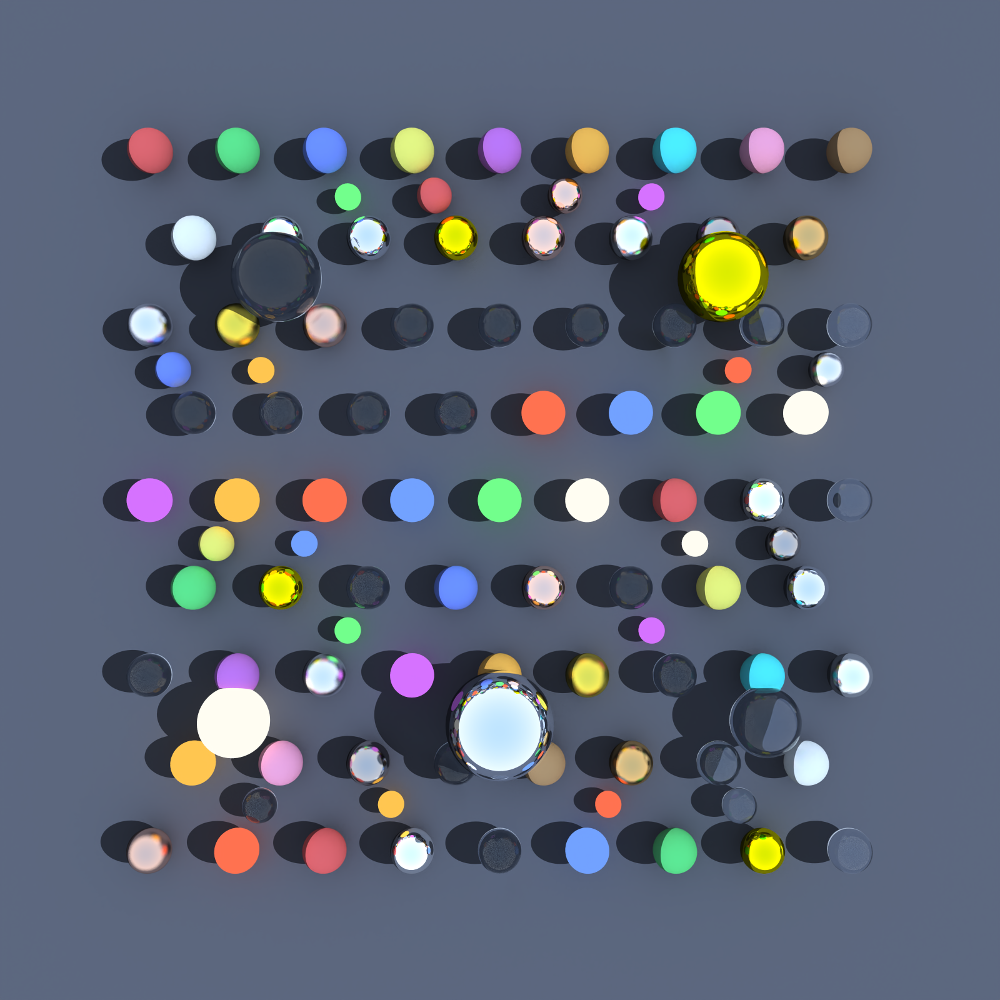

*BVH acceleration test with multiple objects*

### Random Scene
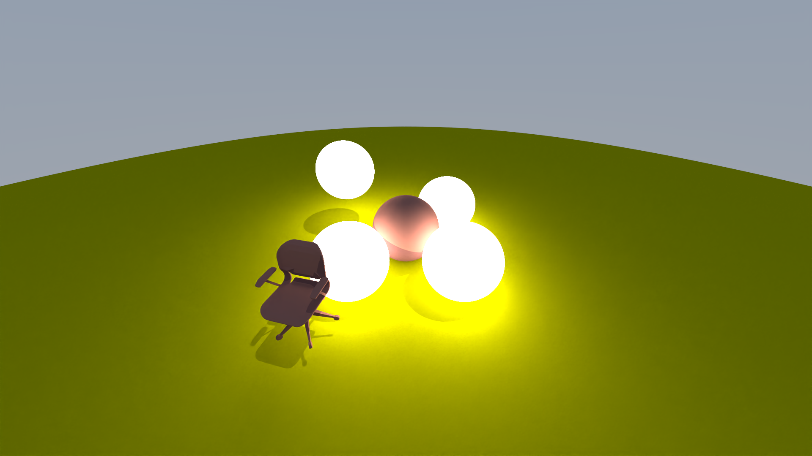

*Scene with Chair Obj Rendering and Point Light Material*

---

## 🔬 Phase 1: correct baseline (before → after)

Cornell box with water, 320×320, 4 threads, no denoising. The old
integrator had no working light sampling (see
[docs/PHASE1_CHANGES.md](docs/PHASE1_CHANGES.md)), so the "before" image
is noisy and also *wrong*: the ceiling light contributed no direct
illumination.

| Before, 64 spp (70.1 s) | After, 64 spp (5.3 s) | After, equal time: 832 spp (60.4 s) |
|---|---|---|
| 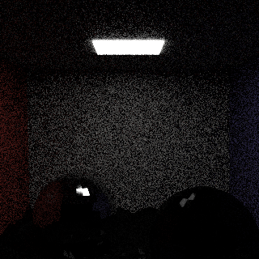 | 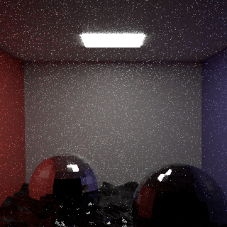 | 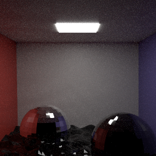 |

Light transport strategies at equal samples (16 spp). All three converge to
the same image (verified by the test suite); they differ only in noise:

| BSDF sampling only | Light sampling only (NEE) | MIS (default) |
|---|---|---|
| 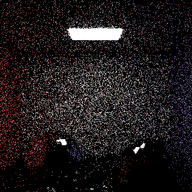 | 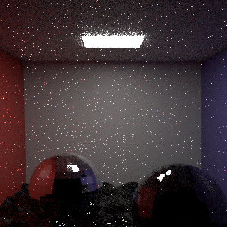 | 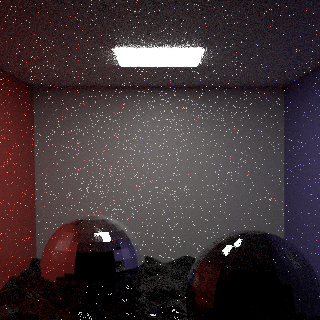 |

Render time at equal settings (same machine, `--no-denoise`):

| Scene | Before | After |
|---|---|---|
| Cornell water (7k triangles), 320², 64 spp | 70.1 s | 5.3 s |
| Hundred spheres, 400², 32 spp | 5.1 s | 1.4 s |
| GGX test, 400², 32 spp | 0.88 s | 0.50 s |
| Stanford bunny (144k triangles), 400², 16 spp | did not finish in 300 s (O(n²) BVH build) | 1.2 s |

The new renderer also does more work per sample: one shadow ray per bounce
for next event estimation.

---

## 📏 Phase 2: equal-time measurement

Six benchmark scenes, three light-transport strategies, 30 s per render,
two seeds, error against 16384-spp references
([docs/BENCHMARKING.md](docs/BENCHMARKING.md#results-preliminary) has the
protocol, the full table and the caveats):

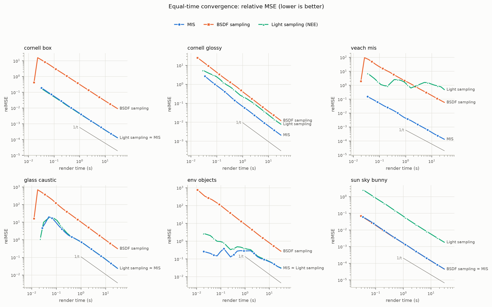

| Scene | BSDF sampling / MIS | Light sampling / MIS |
|---|---:|---:|
| Cornell box | 71x | 0.99x |
| Cornell glossy | 5.8x | 3.8x |
| Veach MIS | 441x | 3924x |
| Glass caustic | 13x | 0.99x |
| Objects under HDR sky | 9.0x | 1.04x |
| Bunny, sun and sky | 0.99x | 41x |

Ratios are equal-time relMSE (reference noise removed); above 1 means more
error than MIS. MIS stays within 1% of the better single strategy in every
scene. These are preliminary numbers from a 4-core cloud container; the
references will be re-rendered at higher sample counts before publication.

The renders behind those numbers (30 s each, seed 1), next to the 16384-spp
references. BSDF sampling is noisy wherever the lights are small; light
sampling fails on the sharp plates under Veach's large lights. The white
specks MIS leaves in the glass scene are caustics, which only BSDF sampling can
find:

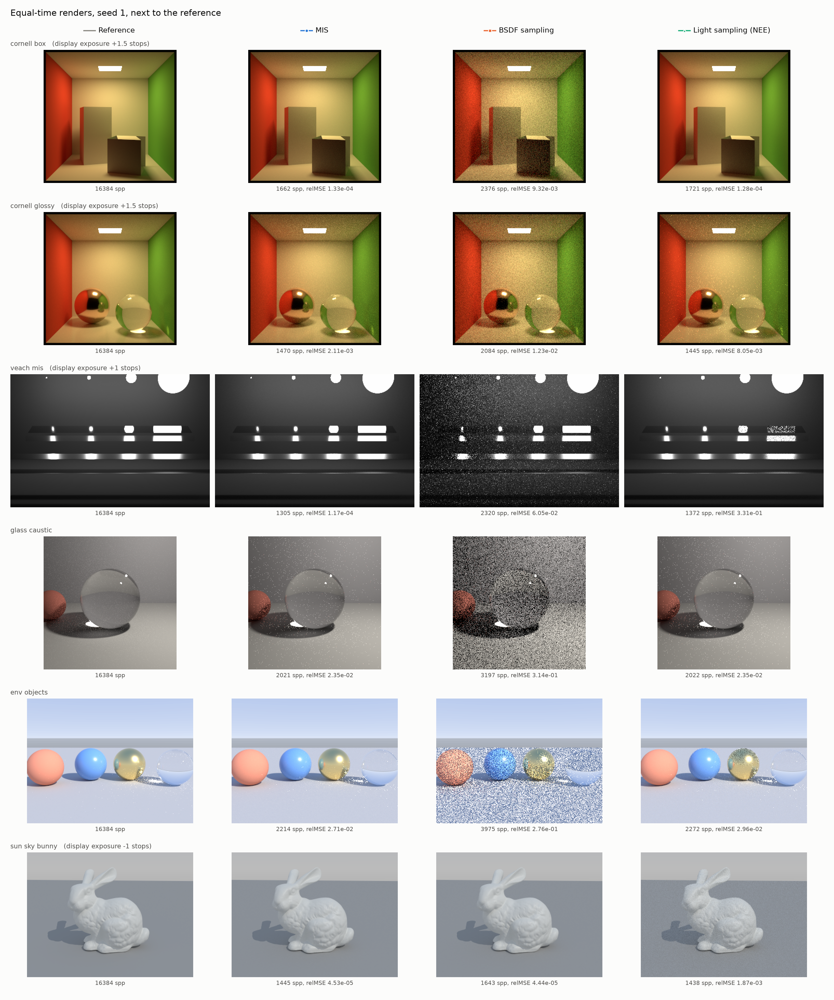

---

## 🎬 Demo Video

### Interactive GUI Demo
https://github.com/user-attachments/assets/c7d5e7fc-0869-4a4a-a583-cdb865517261

### Real-time Rendering Demo
https://github.com/user-attachments/assets/403ced99-433a-45d6-b9a0-a9b650111db7

> Demonstration videos showing the interactive GUI and real-time rendering capabilities.

---

## 📖 Key Concepts Implemented

### The Rendering Equation
```
Lo(x,ωo) = Le(x,ωo) + ∫ f(x,ωi,ωo) Li(x,ωi) cos(θi) dωi
```

### BVH Acceleration
Reduces ray-scene intersection from **O(n)** to roughly **O(log n)** using:
- Axis-Aligned Bounding Boxes (AABB)
- Binned Surface Area Heuristic (SAH) construction (16 bins)

### Research Direction
See [docs/RESEARCH_DIRECTION.md](docs/RESEARCH_DIRECTION.md): physically
based insertion of synthetic objects into captured Gaussian scenes. The
capture lights the objects, the objects shadow and color the capture, and a
closed-loop evaluation attributes the error to its source.
[docs/LITERATURE_REVIEW.md](docs/LITERATURE_REVIEW.md) has the prior work it
is positioned against.

### GGX Microfacet Model
Physically accurate BRDF with:
- Normal Distribution Function (NDF)
- Smith Geometry Function
- Schlick Fresnel Approximation

---

## 👥 Authors

- **Abu Bakar**

**Supervisor:** Professor Olivier Staadt  
**Institution:** University of Rostock  
**Course:** Project CSI - Visual and Analytical Computing (12 ECTS)

---

## 📄 License

This project is licensed under the MIT License - see the [LICENSE](LICENSE) file for details.

---

## 🙏 Acknowledgements

- [Ray Tracing in One Weekend](https://raytracing.github.io/) by Peter Shirley
- [Intel Open Image Denoise](https://www.openimagedenoise.org/)
- [Dear ImGui](https://github.com/ocornut/imgui)
- [GLFW](https://www.glfw.org/)
- [GLM](https://github.com/g-truc/glm)
