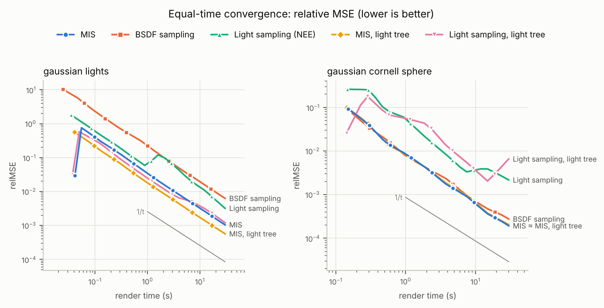
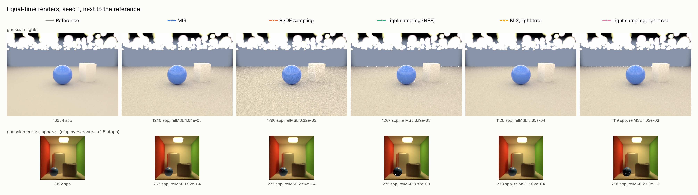
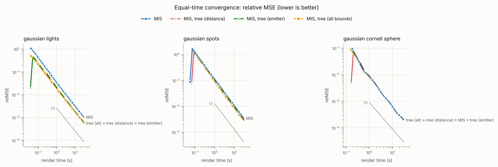
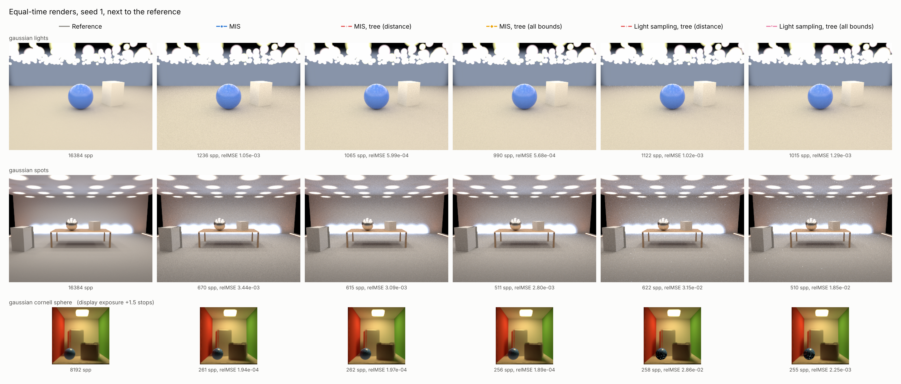

# Gaussian fields: 3DGS captures inside the path tracer

Stage 1 of [RESEARCH_DIRECTION.md](RESEARCH_DIRECTION.md). The renderer
loads a 3D Gaussian Splatting (3DGS) capture and path traces it together with
ordinary geometry: the capture is seen directly, lights the objects through
BSDF rays, and blocks light, including on shadow rays.

## Using it

```xml
<Objects>
  <GaussianField file="capture.ply">     <!-- relative to the scene file -->
    <Position x="0" y="0" z="0"/>
    <Scale value="1"/>                    <!-- uniform -->
    <Rotation x="0" y="0" z="0"/>         <!-- degrees, applied as Rx Ry Rz -->
  </GaussianField>
  <Sphere> ... </Sphere>                  <!-- inserted geometry as usual -->
</Objects>
```

The file is the standard binary `.ply` written by 3DGS trainers (the
reference implementation, gsplat, nerfstudio's splatfacto): `x y z`,
`f_dc_*`, `f_rest_*` (spherical harmonics of degree 0 to 3), `opacity`
(logit), `scale_*` (log), `rot_*` (quaternion w, x, y, z). At most one field
per scene; the transform places it in the scene, and view-dependent colour is
evaluated in the field's own frame, so rotating a capture needs no rotation
of its SH coefficients.

## Radiance model

The 3DGRT particle model (Moenne-Loccoz et al. 2024). Gaussian i meets a ray
at its point of maximum response t_i with opacity
alpha_i = o_i exp(-d_i^2 / 2) (d_i the Mahalanobis distance of the ray to the
mean there) and radiance c_i(direction) = SH + 0.5, clamped at 0. Along a
segment the field adds

    L = sum_i T_i alpha_i c_i,   T_i = prod over t_j < t_i of (1 - alpha_j)

and lets through T = prod_i (1 - alpha_i) of whatever lies behind it. As in
the reference rasterizer, opacities are clamped to 0.99 and responses below
1/255 ignored (each Gaussian's bounding box is sized to exactly that
cut-off); unlike it, there is no early ray termination, so the sum is exact
for this model. The field emits and absorbs; it does not scatter.

In the integrator, every ray segment (camera, bounce) collects the field's
emission up to the next surface and is attenuated by its transmittance;
shadow rays are attenuated too.

## Light sampling (stage 2)

The field's radiance at a shading point x is a sum of per-Gaussian terms
T_i alpha_i c_i, so next event estimation treats every Gaussian as its own
light, like a mesh with many small emitters:

1. The light sampler picks the field (by its total power, against the
   scene's other lights), then Gaussian i with probability P_i. Two choices:
   - `power` (default): in proportion to the Gaussian's emitted power,
     Phi_i = 8 pi^2 o_i L_i s1 s2 s3 sqrt((s1^-2 + s2^-2 + s3^-2) / 3)
     (L_i the luminance of its view-independent colour; the exact flux
     with |M w| replaced by its RMS over directions). The same everywhere.
   - `tree` (`--field-sampler tree`, or `sampler="tree"` on the
     `<GaussianField>`): a light hierarchy on the field's acceleration
     structure. From the root, each step picks a child with probability
     proportional to an estimate of its contribution at the shading point
     x; a leaf picks among its Gaussians the same way. P_i is the product of
     the branch probabilities, recomputed for MIS by walking from Gaussian
     i's leaf to the root (branch probabilities shared by the Gaussians one
     ray passes are computed once per ray). The estimate of a node with
     power Phi, centre c, half-diagonal r, d = |c - x| and w = (c - x) / d
     is (stage 2c)

         emitter(w) / max(d^2, r^2) * cos_bound(n, w, r / d),

     - *emitter*: a Gaussian's emission toward x is o L(w) A(w), with
       A(w) = 2 pi |M w| / |det M| its exact projected area (a flat
       Gaussian is thin edge-on) and L(w) its SH radiance toward x, floored
       at a tenth of its view-independent radiance (L(w) is evaluated at one
       direction, the Gaussian is seen over a range). For a node,
       sum_i o_i L_i A_i(w) <= sqrt(W w^T Q w) by Cauchy-Schwarz, with
       W = sum_i o_i L_i and Q = sum_i o_i L_i (2 pi / |det M_i|)^2 M_i^T M_i,
       stored per node (6 floats); the SH lobe enters as the node's
       power-weighted luminance SH (SH is linear), the same floor applies.
       Near nodes (d < 2r), where w says little, use Phi / 4 pi.
     - *receiver*: below the horizon of an opaque surface nothing is
       reflected. cos_bound is 0 if the node's box lies below the tangent
       plane (its highest point, n.(c - x) + sum_a |n_a| h_a, is not above
       it; exact for axis-aligned normals), else the largest cosine between
       n and the cone of directions to the node's bounding sphere,
       cos(max(0, theta_c - theta_b)) with sin theta_b = r / d. It is 1 at
       volumes, transmissive materials, or inside the sphere. Boxes contain
       every Gaussian's support, so the bound is conservative: a Gaussian
       that reaches above the horizon keeps a positive probability.

     `tree-distance` keeps only Phi / max(d^2, r^2) (the hierarchy of stage
     2b), `tree-emitter` drops the receiver bound. The estimate only steers
     sampling: MIS uses the same P_i, so it changes variance, never the
     expected value. A node can reach above the horizon while all its
     children lie below it; a sample that gets there picks nothing (as in
     pbrt-v4's light BVH). Any Gaussian it could have picked lies below the
     horizon, so the sample is worth nothing either way, and it saves the
     shadow ray.
2. It draws a point y from the 3D Gaussian N(mu_i, Sigma_i) and connects
   x to it. The direction density is a closed-form line integral,

       p_i(w) = integral over t > 0 of N(x + t w; mu_i, Sigma_i) t^2 dt
              = (2 pi)^-3/2 |det M| e^{-d^2/2} / beta
                * [ (t*^2 + 1/beta^2) I0 + (t*/beta) e^{-beta^2 t*^2 / 2} ],

   with a = M (x - mu), b = M w, beta = |b|, t* = -a.b / beta^2, d^2 the
   whitened distance at t*, I0 = sqrt(pi/2) erfc(-beta t* / sqrt 2). It is
   invariant under the field's rotation and uniform scale.
3. The sample estimates term i only: alpha_i c_i at Gaussian i's maximum
   response along w, times the transmittance of surfaces and of every other
   Gaussian in front of it (Gaussian i itself is excluded from the shadow
   ray's transmittance).

On a BSDF-sampled ray, each Gaussian the ray passes is MIS-weighted against
its own light density P_field P_i p_i(w) with the power heuristic; a
Gaussian light sampling never picks (zero power) keeps weight 1. With
`--integrator nee`, field emission on BSDF rays counts only for such
Gaussians and after specular bounces. All three strategies are unbiased for
the particle model (tested below).

## Results: light sampling at equal time

`benchmarks/results/gaussian_lighting/`: 30 s per render, 2 seeds, 4 cores.
Two scenes with a Gaussian field as the only light:

- `gaussian_cornell_sphere`: the 155k-Gaussian stand-in of the Cornell box
  with the blue sphere inserted, 128x128, 8192-spp reference. One lamp
  carries almost all the power.
- `gaussian_lights`: 400 small bright Gaussians spread over a 14x14 area
  and a dim wall (`benchmarks/scenes/`), 320x240, 16384-spp reference.



relMSE (reference noise removed, mean of 2 seeds), relative to MIS with
power selection, on the whole image and on surfaces only (pixels where the
camera ray hits geometry, `benchmarks/region_metrics.py`; elsewhere the
camera sees the field directly and every strategy does the same):

| Method | Cornell stand-in: image | surfaces (sphere) | many lights: image | surfaces |
|---|---:|---:|---:|---:|
| MIS, power selection | 1.0 (1.9e-4) | 1.0 (4.7e-3) | 1.0 (1.0e-3) | 1.0 (1.7e-3) |
| BSDF sampling | 1.43 | 1.58 | 6.0 | 6.1 |
| light sampling, power | 13.3 | 16.1 | 3.1 | 3.1 |
| MIS, light tree | 1.07 | 1.07 | **0.54** | **0.54** |
| light sampling, light tree | 80 | 98 | 1.17 | 1.16 |

- **Light sampling of the field works, and MIS is never worse than the
  better single strategy.** Against BSDF sampling, the 3DGRT-style way of
  lighting objects from a capture, MIS lowers the error 1.6x on the
  sphere and 6x in the many-lights scene.
- **The light hierarchy wins where it should.** With 400 lights at very
  different distances it halves MIS's error (0.54x), although it renders
  10% fewer samples in the same time; light sampling alone improves 2.6x.
- **And loses where its heuristic is wrong.** In the stand-in, one lamp
  dominates. Power over distance moves probability from the lamp to the
  wall Gaussians near the sphere: light sampling alone becomes
  heavy-tailed (rare lamp samples with huge weights; its curve rises at
  the end), and MIS was 7% worse in this run. We attributed this to the
  flat wall Gaussians seen edge-on and expected an orientation bound to fix
  it. Stage 2c below shows otherwise: the receiver bound removes the tail,
  the orientation bound does not, and the 7% is within run-to-run noise.

In this run `mis_tree` / `nee_tree` are the stage 2b hierarchy, called
`tree-distance` since stage 2c.



## Results: the light tree's bounds (stage 2c)

`benchmarks/results/light_tree_bounds/`: the ablation of the node
estimate, 30 s per render, 2 seeds, 4 cores. The two scenes above and
`gaussian_spots` (`benchmarks/scenes/`, 320x240, 16384-spp reference):
24 flat downlights, 10 wall washers and 80 floor uplights, all with SH
degree-1 lobes, around a table. Power over distance misjudges all of
them: the lobes send little light sideways, the flat ones are thin
edge-on, and many lie below the horizon of most surfaces.

relMSE (reference noise removed, mean of 2 seeds) relative to MIS with
power selection at equal time; in brackets, per sample (the ratio times
the ratio of samples rendered), which shows what the estimate buys
before its cost:

| Selection | Cornell stand-in | many lights | spotlights | samples in 30 s, vs power |
|---|---:|---:|---:|---:|
| MIS, power | 1.0 (2.0e-4) | 1.0 (1.0e-3) | 1.0 (3.5e-3) | 1 |
| MIS, tree: distance (2b) | 1.00 (0.99) | 0.56 (0.49) | 0.90 (0.83) | 0.99 / 0.87 / 0.92 |
| MIS, tree: + emitter | 1.03 (0.99) | 0.59 (0.50) | 0.88 (0.72) | 0.96 / 0.84 / 0.82 |
| MIS, tree: all bounds | 0.97 (0.95) | **0.55** (0.43) | **0.81** (0.62) | 0.98 / 0.79 / 0.77 |
| light sampling, power | 13.4 | 3.1 | 4.7 | |
| light sampling, tree: distance | 74 | 1.19 | 5.9 | |
| light sampling, tree: + emitter | 77 | 1.32 | 4.6 | |
| light sampling, tree: all bounds | **10.7** | 1.32 | **4.6** | |

Spread between the two seeds of light sampling alone (larger relMSE over
smaller; heavy tails show up as a large spread):

| Selection | Cornell stand-in | many lights | spotlights |
|---|---:|---:|---:|
| power | 3.2 | 1.02 | 1.31 |
| tree: distance | 20 | 1.43 | 3.2 |
| tree: + emitter | 19 | 1.42 | 1.26 |
| tree: all bounds | **1.08** | 1.12 | 1.41 |

On surfaces only (`plots/regions.md`) the ratios are the same within 0.01,
except the Cornell sphere: MIS with all bounds 0.96, light sampling 12.7
against 91 with the distance tree.

- **Per sample, every bound does what it is for.** With view-dependent,
  flat lights, MIS's error per sample falls from 0.83 (distance) to 0.72
  (emitter) to 0.62 (all bounds). With 400 small isotropic lights the
  emitter term has nothing to see (0.49 to 0.50), and all bounds together
  gain 12% over distance alone.
- **At equal time the full tree wins or ties.** It renders 2-23% fewer
  samples than power selection and 2-16% fewer than the distance tree. In
  the spotlight scene the full tree is the best variant
  (0.81, against 0.90 for the distance tree); with many isotropic lights
  it ties with the distance tree (0.55 against 0.56); in the stand-in all
  variants are within noise of power selection.
- **The receiver bound removes the heavy tail of light sampling.** With
  the distance tree, and still with the emitter term, light sampling in
  the stand-in has one seed 20x worse than the other; with all bounds the
  two seeds agree within 8%, and the error is 7x lower than the distance
  tree's and 1.25x lower than power selection's. In the spotlight scene
  the distance tree's 3.2x spread also returns to that of power
  selection. What misled the distance heuristic was mostly probability
  given to Gaussians below the receiver's horizon, not flat Gaussians
  seen edge-on, as stage 2b had guessed.
- **Cost matters as much as the estimate.** The first implementation
  rendered 30% fewer samples than the distance tree in the spotlight scene
  and lost to it at equal time, although its per-sample error was the
  same as here. It evaluated SH of degree 3 for every channel at every
  node and leaf, used four square roots per horizon bound, and computed
  each leaf weight twice. Evaluating SH only to the field's degree, one
  luminance SH per Gaussian, and a two-root horizon bound gave the numbers
  above with identical probabilities up to the luminance change.
- **Noise.** MIS with power selection in the stand-in moved 6% between two
  runs of the same code (the sample count depends on machine load), so
  differences under about 5% are not significant; two seeds per method. The stage 2b
  run's 1.07 for the distance tree in the stand-in is 1.00 here.





## Tests

`tests/test_gaussians.cpp`:

| Test | Checks |
|---|---|
| `sh_basis_is_orthonormal_and_matches_reference` | Gram matrix of the 16 basis functions by quadrature; spot values against the reference formulas; clamp at 0 |
| `gaussian_ply_loads_like_the_reference` | a file in the reference layout: sigmoid opacity, clamp, log scales, unnormalized quaternion, channel-major `f_rest`, dropping of invisible Gaussians, loading and placing through a scene file |
| `gaussian_alpha_matches_closed_form` | one rotated anisotropic Gaussian: alpha through the mean and off-axis, segment limits |
| `gaussian_field_matches_brute_force_and_transforms` | 300 random Gaussians, 400 rays: acceleration structure + sorting equals brute force; a transformed field equals the untransformed one in local coordinates |
| `gaussian_field_lights_a_floor` | the field as the only light: floor radiance against quadrature, all strategies |
| `gaussian_field_shadows_a_point_light` | a black Gaussian on a shadow ray passes exactly 1 - opacity |
| `gaussian_field_attenuates_what_is_behind_it` | an emitter seen through a Gaussian |
| `gaussian_emission_sampling_matches_pdf` | the direction density integrates to 1 (outside and inside the Gaussian); the sampler reports it; a chi-square test of sampled directions on a gnomonic grid |
| `gaussian_field_light_sampling_is_unbiased` | 14 overlapping Gaussians (view-dependent colour, a small bright lamp Gaussian, a zero-power Gaussian with a positive SH lobe) and a point light shadowed by them: every strategy and both selections against a quadrature of the field's own trace(); MIS less noisy than BSDF sampling |
| `gaussian_light_tree_selection_is_consistent` | 500 flat, rotated, view-dependent Gaussians under a transform, every tree variant, with and without a normal: probabilities sum to 1 at any point (at most 1 with the receiver bound, and failed selections occur exactly that often), the reported pmf matches, sampled choices pass a chi-square test; a near light beats an equally bright far one, power selection does not care |
| `gaussian_light_tree_mis_weights_match_its_sampling` | a near and a far Gaussian where tree and power selection disagree: every strategy against quadrature, every tree variant |
| `gaussian_light_tree_receiver_bound_is_conservative` | 400 Gaussians at tilted normals: probability zero exactly where a Gaussian's support box lies below the tangent plane, positive wherever it reaches above |
| `gaussian_light_tree_mis_is_consistent_across_points` | rays alternating between two floor points, Gaussians low over the horizon whose probabilities the receiver bound changes more than 2x: MIS and light sampling against each point's quadrature |

Mutation-tested. Stage 1: compositing without sorting, dropping the path
attenuation or the shadow-ray transmittance, a transposed whitening matrix,
coefficient-major `f_rest`. Stage 2: the direction pdf without its t^2
Jacobian, MIS weights without the field's or the Gaussian's selection
probability, a sampled Gaussian blocking its own light, ignoring light-
sampling-only mode, dropping zero-power Gaussians, and sampling with the
whitening matrix instead of its inverse; for the tree, a pmf walk that
swaps the children and MIS weights that use the power pmf while sampling
uses the tree. Stage 2c: MIS weights without the receiver normal, a
per-ray branch memo that is never reset, a horizon bound that ignores the
node's extent, and a plane test without the box's extent or dropped
altogether. Every one is caught. Four first slipped through and led to
better tests: the zero-power test Gaussian's lobe faced away from the
floor; the power-pmf weights were invisible in a scene where both
selections agree (the near/far test was written for it); and the receiver
normal and the memo were invisible while every test shaded a single point
under a single BVH leaf (the across-points test).

What the tests cannot catch, by design: the node estimate only steers
sampling, so a worse estimate (no orientation term, no SH floor, a normal
given to a transmissive surface) changes variance, not the expected value.
Those are judged by the benchmark below.

## A Gaussian scene without a GPU

Training 3DGS needs a CUDA GPU. To run the insertion loop without one,
`benchmarks/points_to_gaussians.py` builds an *unoptimized* stand-in from a
dataset ([DATASETS.md](DATASETS.md)): every few training pixels become a
flat Gaussian on the visible surface, oriented by the normal map, sized by
the pixel footprint (stretched along the view direction at grazing angles)
and coloured with the pixel's HDR radiance. It is crude (blurred edges,
emitters grown at grazing angles, view-dependent effects baked per view),
but it has the right structure: a trained 3DGS `.ply` of the same dataset
replaces it one to one.

`benchmarks/insertion_demo.py` then renders a test view of the Gaussian
scene alone and with the dataset's inserted objects, the field being the
only light, and scores both against the path-traced ground truth in three
regions: the object, its influence region (where the ground truth with and
without the object differ: shadow, reflected light) and the rest.


`cornell_box` with the blue sphere: 24 training views at 1024 spp, a stand-in
of 154,711 Gaussians (`--stride 3`), test view 1 at 256 spp, 3.5 minutes for
both renders on 4 cores. relMSE against ground truth, mean (median):

| Comparison | object | influence | rest |
|---|---:|---:|---:|
| Gaussian scene vs. the scene it reconstructs | 0.0157 (0.0011) | 0.0086 (0.0005) | 52.8 (0.0013) |
| Gaussian scene + sphere vs. ground truth | 0.0367 (0.0021) | 0.099 (0.0007) | 53.6 (0.0012) |
| Ground truth without the sphere vs. with it | 0.427 (0.13) | 0.106 (0.0016) | 0.0001 (0.00001) |

(relMSE per channel, as in the metrics library. These renders predate
light sampling of the field, stage 2.)

- **Object.** The sphere, lit only by the Gaussian scene, has 12x lower error
  than leaving it out. What remains is mostly noise: the stand-in's lamp is a
  cluster of small bright Gaussians that only BSDF rays find (the speckled
  highlight). That is contribution C1's target.
- **Influence.** 0.099 against 0.106 for ignoring the sphere altogether: the
  sphere's shadow and the blue light it reflects onto the floor and the red
  wall are missing, because the field does not receive light. That is
  contribution C2's target, now measured.
- **Rest.** The median (0.0012) is the stand-in's reconstruction error. The
  mean is 54 because 1% of the pixels carry 93% of it: where the stand-in's
  enlarged lamp (luminance about 9) covers dark ceiling (about 0.08). A mean
  alone would misreport the reconstruction, so the demo reports both.

Reproduce:

```bash
python3 benchmarks/make_dataset.py cornell_box --insert benchmarks/inserts/cornell_blue_sphere.xml \
    --poses jitter --train 24 --test 4 --spp 1024 --width 256 --exposure 1.5
python3 benchmarks/points_to_gaussians.py datasets/cornell_box --stride 3
python3 benchmarks/insertion_demo.py datasets/cornell_box --view 1 --spp 256
```

## Limitations

- One field per scene; the field does not scatter light, so the inserted
  object's shadow and reflected light do not appear on the capture
  (contribution C2).
- The light tree's estimate is a heuristic of the receiver's horizon, not
  of its BSDF: a glossy receiver gets the same probabilities as a diffuse
  one, and its SH term looks at one direction per node rather than bounding
  emission over the cone of directions to it. Its cost (up to 23% of the
  samples in the scenes above) decides whether it pays off at equal time.
- The particle model is what a trained 3DGS shows when ray traced, not a
  continuous volume; a ray's result depends on the order of maximum
  responses, as in 3DGRT.
- CPU traversal: a binary median-split BVH over the Gaussians' support
  boxes and a sort per ray. About 15 s for 256x256 at 16 spp through 155k
  Gaussians on 4 cores. Fast enough for experiments, not for interaction.
