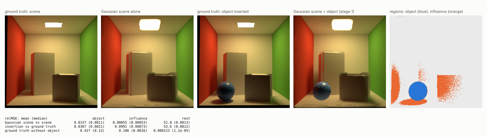

# Gaussian fields: 3DGS captures inside the path tracer

Stage 1 of [RESEARCH_DIRECTION.md](RESEARCH_DIRECTION.md). The renderer
loads a 3D Gaussian Splatting (3DGS) capture and path traces it together with
ordinary geometry: the capture is seen directly, lights the objects through
BSDF rays, and blocks light, including on shadow rays.

## Using it

```xml
<Objects>
  <GaussianField file="capture.ply">     <!-- relative to the scene file -->
    <Position x="0" y="0" z="0"/>
    <Scale value="1"/>                    <!-- uniform -->
    <Rotation x="0" y="0" z="0"/>         <!-- degrees, applied as Rx Ry Rz -->
  </GaussianField>
  <Sphere> ... </Sphere>                  <!-- inserted geometry as usual -->
</Objects>
```

The file is the standard binary `.ply` written by 3DGS trainers (the
reference implementation, gsplat, nerfstudio's splatfacto): `x y z`,
`f_dc_*`, `f_rest_*` (spherical harmonics of degree 0 to 3), `opacity`
(logit), `scale_*` (log), `rot_*` (quaternion w, x, y, z). At most one field
per scene; the transform places it in the scene, and view-dependent colour is
evaluated in the field's own frame, so rotating a capture needs no rotation
of its SH coefficients.

## Radiance model

The 3DGRT particle model (Moenne-Loccoz et al. 2024). Gaussian i meets a ray
at its point of maximum response t_i with opacity
alpha_i = o_i exp(-d_i^2 / 2) (d_i the Mahalanobis distance of the ray to the
mean there) and radiance c_i(direction) = SH + 0.5, clamped at 0. Along a
segment the field adds

    L = sum_i T_i alpha_i c_i,   T_i = prod over t_j < t_i of (1 - alpha_j)

and lets through T = prod_i (1 - alpha_i) of whatever lies behind it. As in
the reference rasterizer, opacities are clamped to 0.99 and responses below
1/255 ignored (each Gaussian's bounding box is sized to exactly that
cut-off); unlike it, there is no early ray termination, so the sum is exact
for this model. The field emits and absorbs; it does not scatter.

In the integrator, every ray segment (camera, bounce) collects the field's
emission up to the next surface and is attenuated by its transmittance;
shadow rays are attenuated too.

## Light sampling (stage 2)

The field's radiance at a shading point x is a sum of per-Gaussian terms
T_i alpha_i c_i, so next event estimation treats every Gaussian as its own
light, like a mesh with many small emitters:

1. The light sampler picks the field (by its total power, against the
   scene's other lights), then Gaussian i with probability P_i. Two choices:
   - `power` (default): in proportion to the Gaussian's emitted power,
     Phi_i = 8 pi^2 o_i L_i s1 s2 s3 sqrt((s1^-2 + s2^-2 + s3^-2) / 3)
     (L_i the luminance of its view-independent colour; the exact flux
     with |M w| replaced by its RMS over directions). The same everywhere.
   - `tree` (`--field-sampler tree`, or `sampler="tree"` on the
     `<GaussianField>`): a light hierarchy on the field's acceleration
     structure. From the root, each step picks a child with probability
     proportional to its power over the squared distance from the shading
     point to its centre, the distance clamped below by the node's
     half-diagonal; a leaf picks among its Gaussians the same way. P_i is
     the product of the branch probabilities, recomputed for MIS by walking
     from Gaussian i's leaf to the root, so it depends on the shading point
     and favours nearby emitters.
2. It draws a point y from the 3D Gaussian N(mu_i, Sigma_i) and connects
   x to it. The direction density is a closed-form line integral,

       p_i(w) = integral over t > 0 of N(x + t w; mu_i, Sigma_i) t^2 dt
              = (2 pi)^-3/2 |det M| e^{-d^2/2} / beta
                * [ (t*^2 + 1/beta^2) I0 + (t*/beta) e^{-beta^2 t*^2 / 2} ],

   with a = M (x - mu), b = M w, beta = |b|, t* = -a.b / beta^2, d^2 the
   whitened distance at t*, I0 = sqrt(pi/2) erfc(-beta t* / sqrt 2). It is
   invariant under the field's rotation and uniform scale.
3. The sample estimates term i only: alpha_i c_i at Gaussian i's maximum
   response along w, times the transmittance of surfaces and of every other
   Gaussian in front of it (Gaussian i itself is excluded from the shadow
   ray's transmittance).

On a BSDF-sampled ray, each Gaussian the ray passes is MIS-weighted against
its own light density P_field P_i p_i(w) with the power heuristic; a
Gaussian light sampling never picks (zero power) keeps weight 1. With
`--integrator nee`, field emission on BSDF rays counts only for such
Gaussians and after specular bounces. All three strategies are unbiased for
the particle model (tested below).

## Tests

`tests/test_gaussians.cpp`:

| Test | Checks |
|---|---|
| `sh_basis_is_orthonormal_and_matches_reference` | Gram matrix of the 16 basis functions by quadrature; spot values against the reference formulas; clamp at 0 |
| `gaussian_ply_loads_like_the_reference` | a file in the reference layout: sigmoid opacity, clamp, log scales, unnormalized quaternion, channel-major `f_rest`, dropping of invisible Gaussians, loading and placing through a scene file |
| `gaussian_alpha_matches_closed_form` | one rotated anisotropic Gaussian: alpha through the mean and off-axis, segment limits |
| `gaussian_field_matches_brute_force_and_transforms` | 300 random Gaussians, 400 rays: acceleration structure + sorting equals brute force; a transformed field equals the untransformed one in local coordinates |
| `gaussian_field_lights_a_floor` | the field as the only light: floor radiance against quadrature, all strategies |
| `gaussian_field_shadows_a_point_light` | a black Gaussian on a shadow ray passes exactly 1 - opacity |
| `gaussian_field_attenuates_what_is_behind_it` | an emitter seen through a Gaussian |
| `gaussian_emission_sampling_matches_pdf` | the direction density integrates to 1 (outside and inside the Gaussian); the sampler reports it; a chi-square test of sampled directions on a gnomonic grid |
| `gaussian_field_light_sampling_is_unbiased` | 14 overlapping Gaussians (view-dependent colour, a small bright lamp Gaussian, a zero-power Gaussian with a positive SH lobe) and a point light shadowed by them: every strategy and both selections against a quadrature of the field's own trace(); MIS less noisy than BSDF sampling |
| `gaussian_light_tree_selection_is_consistent` | 500 Gaussians under a transform: tree probabilities sum to 1 at any point, the reported pmf matches, sampled choices pass a chi-square test; a near light beats an equally bright far one, power selection does not care |
| `gaussian_light_tree_mis_weights_match_its_sampling` | a near and a far Gaussian where tree and power selection disagree: every strategy against quadrature with tree selection |

Mutation-tested. Stage 1: compositing without sorting, dropping the path
attenuation or the shadow-ray transmittance, a transposed whitening matrix,
coefficient-major `f_rest`. Stage 2: the direction pdf without its t^2
Jacobian, MIS weights without the field's or the Gaussian's selection
probability, a sampled Gaussian blocking its own light, ignoring light-
sampling-only mode, dropping zero-power Gaussians, and sampling with the
whitening matrix instead of its inverse; for the tree, a pmf walk that
swaps the children and MIS weights that use the power pmf while sampling
uses the tree. Every one is caught. Two first slipped through and led to
better tests: the zero-power test Gaussian's lobe faced away from the
floor, and the power-pmf weights were invisible in a scene where both
selections agree; the near/far test was written for it.

## A Gaussian scene without a GPU

Training 3DGS needs a CUDA GPU. To run the insertion loop without one,
`benchmarks/points_to_gaussians.py` builds an *unoptimized* stand-in from a
dataset ([DATASETS.md](DATASETS.md)): every few training pixels become a
flat Gaussian on the visible surface, oriented by the normal map, sized by
the pixel footprint (stretched along the view direction at grazing angles)
and coloured with the pixel's HDR radiance. It is crude (blurred edges,
emitters grown at grazing angles, view-dependent effects baked per view),
but it has the right structure: a trained 3DGS `.ply` of the same dataset
replaces it one to one.

`benchmarks/insertion_demo.py` then renders a test view of the Gaussian
scene alone and with the dataset's inserted objects, the field being the
only light, and scores both against the path-traced ground truth in three
regions: the object, its influence region (where the ground truth with and
without the object differ: shadow, reflected light) and the rest.



`cornell_box` with the blue sphere: 24 training views at 1024 spp, a stand-in
of 154,711 Gaussians (`--stride 3`), test view 1 at 256 spp, 3.5 minutes for
both renders on 4 cores. relMSE against ground truth, mean (median):

| Comparison | object | influence | rest |
|---|---:|---:|---:|
| Gaussian scene vs. the scene it reconstructs | 0.0157 (0.0011) | 0.0086 (0.0005) | 52.8 (0.0013) |
| Gaussian scene + sphere vs. ground truth | 0.0367 (0.0021) | 0.099 (0.0007) | 53.6 (0.0012) |
| Ground truth without the sphere vs. with it | 0.427 (0.13) | 0.106 (0.0016) | 0.0001 (0.00001) |

(relMSE per channel, as in the metrics library. These renders predate
light sampling of the field, stage 2.)

- **Object.** The sphere, lit only by the Gaussian scene, has 12x lower error
  than leaving it out. What remains is mostly noise: the stand-in's lamp is a
  cluster of small bright Gaussians that only BSDF rays find (the speckled
  highlight). That is contribution C1's target.
- **Influence.** 0.099 against 0.106 for ignoring the sphere altogether: the
  sphere's shadow and the blue light it reflects onto the floor and the red
  wall are missing, because the field does not receive light. That is
  contribution C2's target, now measured.
- **Rest.** The median (0.0012) is the stand-in's reconstruction error. The
  mean is 54 because 1% of the pixels carry 93% of it: where the stand-in's
  enlarged lamp (luminance about 9) covers dark ceiling (about 0.08). A mean
  alone would misreport the reconstruction, so the demo reports both.

Reproduce:

```bash
python3 benchmarks/make_dataset.py cornell_box --insert benchmarks/inserts/cornell_blue_sphere.xml \
    --poses jitter --train 24 --test 4 --spp 1024 --width 256 --exposure 1.5
python3 benchmarks/points_to_gaussians.py datasets/cornell_box --stride 3
python3 benchmarks/insertion_demo.py datasets/cornell_box --view 1 --spp 256
```

## Limitations

- One field per scene; the field does not scatter light, so the inserted
  object's shadow and reflected light do not appear on the capture
  (contribution C2).
- The light hierarchy weighs power against distance only. It ignores the
  receiver's orientation (a cosine bound) and view-dependent emission (a
  bound on SH emission over the cone of directions to a node), the
  remaining part of contribution C1.
- The particle model is what a trained 3DGS shows when ray traced, not a
  continuous volume; a ray's result depends on the order of maximum
  responses, as in 3DGRT.
- CPU traversal: a binary median-split BVH over the Gaussians' support
  boxes and a sort per ray. About 15 s for 256x256 at 16 spp through 155k
  Gaussians on 4 cores. Fast enough for experiments, not for interaction.
